<picture>
  <source media="(prefers-color-scheme: dark)" srcset="assets/hero-dark.svg">
  
</picture>

**IBM Maximo consultant and developer at Cohesive.** I find and fix problems in IBM Maximo for UK clients. I use SQL, Python and Java. I have worked remotely from Belo Horizonte, Brazil, since 2022.

[Portfolio](https://gabriel-chaves.pages.dev/en/) · [LinkedIn](https://www.linkedin.com/in/gabrielgmchaves/) · [Email](mailto:gabrielchavesgmc@gmail.com)

## Case studies

Real work at Cohesive. The code and the details belong to the clients, so they are not on GitHub.

### Maximo ticket investigation

**Symptom:** error or incorrect data in a client’s Maximo → **Investigation:** database (SQL) and the system core (Java) → **Fix:** data fixed with SQL, bugs in classes found → **Result: 500+ tickets resolved since 2022.**

`Maximo 7.6` `MAS` `Oracle SQL` `SQL Server` `DB2` `Java`

### BIRT reports and data analysis

**Need:** a correct report on the Maximo data → **Query:** queries in SQL and data analysis → **Delivery:** a new or fixed BIRT report → **Result: 50+ reports fixed, changed or built.**

`BIRT` `Oracle SQL` `SQL Server` `DB2` `Maximo`

### Python automation

**Problem:** manual and repetitive support tasks → **Internship:** a work-logging application in Python → **After:** Python scripts for custom automation.

`Python`

## Career

<picture>
  <source media="(prefers-color-scheme: dark)" srcset="assets/career-dark.svg">
  
</picture>

From Intern to Consultant II in 3 years, at the same company.

- **Consultant II** (Apr 2025 – present): main person responsible (focal point) for 3 clients: AGCCE, Bluewater and Rolls-Royce. More complex investigations since the promotion. Main work on Maximo 7.6, with some work on MAS. Building and fixing BIRT reports.
- **Consultant I** (Apr 2024 – Mar 2025) and **Associate Consultant** (Dec 2022 – Apr 2024): IBM Maximo support with tailored solutions for each client. Oracle SQL and SQL Server for data analysis and reports. Python scripts for custom automation. Java for in-depth analysis of the core system.
- **Intern** (Mar 2022 – Nov 2022): IBM Maximo support for UK clients. Work-logging application in Python. Reading Java code to find and fix bugs in classes. SQL for reports, data analysis and data fixes.

## Skills

- **Platforms:** IBM Maximo 7.6 (main), MAS, BIRT reports
- **Languages and data:** Python, Java, SQL (Oracle SQL, SQL Server, DB2), R (Tidyverse, ggplot2)
- **Certifications:** IoT – Maximo Introduction and Overview · IoT – Maximo Database Configuration
- **Education:** Associate degree in Systems Analysis and Development, PUC Minas (2021 – 2023)
- **Languages:** Portuguese (native), English (fluent, every day with UK clients), Spanish (basic)

<strong>Ler em português</strong>

 

**Consultor IBM Maximo e desenvolvedor na Cohesive.** Encontro e corrijo problemas no IBM Maximo para clientes do Reino Unido. Uso SQL, Python e Java. Trabalho remoto de Belo Horizonte desde 2022.

- **Investigação de chamados no Maximo:** sintoma → investigação no banco (SQL) e no núcleo do sistema (Java) → correção dos dados com SQL → **500+ chamados resolvidos desde 2022.**
- **Relatórios BIRT e análise de dados:** consultas em SQL e relatórios BIRT novos ou corrigidos → **50+ relatórios corrigidos, modificados ou criados.**
- **Automação com Python:** aplicativo de registro de trabalho no estágio e, depois, scripts de automação.
- **Trajetória:** de estagiário a Consultor II em 3 anos, na mesma empresa. Hoje, sou responsável principal (ponto focal) de 3 clientes: AGCCE, Bluewater e Rolls-Royce.

[Portfólio](https://gabriel-chaves.pages.dev/) · [LinkedIn](https://www.linkedin.com/in/gabrielgmchaves/) · [E-mail](mailto:gabrielchavesgmc@gmail.com)

